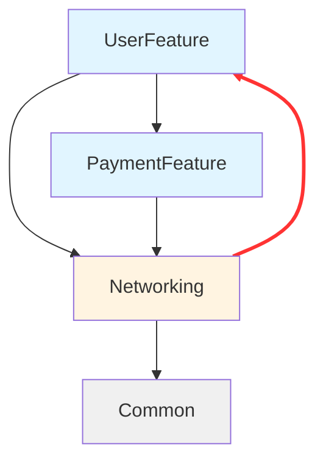

# 提示词：生成模块依赖图

## 场景说明

分析多模块 iOS 项目的依赖关系，生成 Mermaid 格式的可视化依赖图，识别循环依赖、违反分层规则的依赖等架构问题。

## 输入要求

- **必需**：项目模块清单（可从 `Package.swift`、`Podfile`、Xcode 项目结构提取）
- **必需**：每个模块的 import 语句或依赖声明
- **可选**：已定义的架构分层规则（如 Feature → Core → Foundation）
- **可选**：现有的 `ARCHITECTURE.md` 文件（如需更新）

## 提示词模板

```
请分析这个多模块 iOS 项目的依赖关系，生成依赖图并检查架构问题。

## 项目信息

### 模块类型
- Swift Package Manager 本地包
- [或：Xcode Frameworks / CocoaPods Pods]

### 模块清单
[粘贴以下内容之一：]

**选项 1：Package.swift 内容**
\`\`\`swift
// swift-tools-version:5.9
import PackageDescription

let package = Package(
    name: "MyApp",
    products: [
        .library(name: "UserFeature", targets: ["UserFeature"]),
        .library(name: "Networking", targets: ["Networking"]),
    ],
    dependencies: [],
    targets: [
        .target(name: "UserFeature", dependencies: ["Networking", "DesignSystem"]),
        .target(name: "Networking", dependencies: ["Common"]),
        .target(name: "DesignSystem", dependencies: ["Common"]),
        .target(name: "Common", dependencies: []),
    ]
)
\`\`\`

**选项 2：项目目录结构 + import 语句**
\`\`\`
Packages/
├── UserFeature/
│   └── Sources/
│       └── UserService.swift    # import Networking, DesignSystem
├── Networking/
│   └── Sources/
│       └── NetworkClient.swift  # import Common
└── Common/
    └── Sources/
        └── Extensions.swift     # 无外部依赖
\`\`\`

**选项 3：Podfile 内容**
\`\`\`ruby
target 'MyApp' do
  pod 'UserFeature', :path => 'Pods/UserFeature'
  pod 'Networking', :path => 'Pods/Networking'
end

# Pods/UserFeature/UserFeature.podspec 中依赖：
# s.dependency 'Networking'
# s.dependency 'DesignSystem'
\`\`\`

### 架构分层规则（可选）
[如已定义，粘贴此处；否则由 AI 推断]

例如：
\`\`\`
Layer 1 (App): MyApp Target
Layer 2 (Feature): UserFeature, PaymentFeature, OrderFeature
Layer 3 (Core): Networking, Storage, Analytics
Layer 4 (Foundation): DesignSystem, Common

规则：
- 高层可依赖低层，反之不可
- Feature 模块之间不可互相依赖
\`\`\`

## 任务要求

1. **解析依赖关系**
   - 识别所有模块（SPM Package / Framework / Pod）
   - 提取每个模块的直接依赖
   - 计算传递依赖（间接依赖）

2. **生成依赖图**
   - 使用 Mermaid `graph TB` 格式
   - 按分层用颜色区分模块（如 Feature 层浅蓝色，Core 层浅黄色）
   - 箭头方向：依赖者 → 被依赖者

3. **检查架构问题**
   - 🔴 循环依赖：A → B → C → A
   - 🟠 反向依赖：底层模块依赖高层模块（如 Networking → UserFeature）
   - 🟡 Feature 间依赖：Feature 模块直接依赖其他 Feature 模块
   - 🟢 孤立模块：没有被任何模块依赖（可能是死代码）

4. **推断分层结构**（如未提供架构规则）
   - 根据依赖方向推断模块所属层级
   - 最底层：无任何外部依赖的模块（如 Common、Utilities）
   - Feature 层：依赖 Core 层，不被 Core 层依赖的模块
   - App 层：依赖所有 Feature 模块的主 Target

## 输出格式

### 1. 依赖图（Mermaid）

\`\`\`mermaid
graph TB
    App[MyApp]
    UserFeature[UserFeature]
    PaymentFeature[PaymentFeature]
    Networking[Networking]
    Storage[Storage]
    DesignSystem[DesignSystem]
    Common[Common]
    
    App --> UserFeature
    App --> PaymentFeature
    UserFeature --> Networking
    UserFeature --> DesignSystem
    PaymentFeature --> Networking
    PaymentFeature --> Storage
    Networking --> Common
    Storage --> Common
    DesignSystem --> Common
    
    %% 样式定义
    style UserFeature fill:#e1f5ff
    style PaymentFeature fill:#e1f5ff
    style Networking fill:#fff4e1
    style Storage fill:#fff4e1
    style DesignSystem fill:#f0f0f0
    style Common fill:#f0f0f0
\`\`\`

### 2. 架构问题清单

#### 🔴 循环依赖
- 无

#### 🟠 反向依赖（违反分层规则）
- 无

#### 🟡 Feature 间依赖
- 无

#### 🟢 孤立模块
- 无

**结论**：✅ 架构健康，无明显问题

### 3. 推断的分层结构

\`\`\`
┌─────────────────────────────┐
│   Layer 1: App              │
│   - MyApp                   │
├─────────────────────────────┤
│   Layer 2: Feature          │
│   - UserFeature             │
│   - PaymentFeature          │
├─────────────────────────────┤
│   Layer 3: Core             │
│   - Networking              │
│   - Storage                 │
├─────────────────────────────┤
│   Layer 4: Foundation       │
│   - DesignSystem            │
│   - Common                  │
└─────────────────────────────┘
\`\`\`

### 4. 模块依赖统计

| 模块 | 直接依赖数 | 被依赖数 | 传递依赖数 |
|------|-----------|---------|-----------|
| MyApp | 2 | 0 | 5 |
| UserFeature | 2 | 1 | 3 |
| PaymentFeature | 2 | 1 | 3 |
| Networking | 1 | 2 | 1 |
| Storage | 1 | 1 | 1 |
| DesignSystem | 1 | 1 | 1 |
| Common | 0 | 4 | 0 |

## 输出结果
[AI 在此处输出完整分析]
```

## 使用示例

### 输入

一个 Swift Package Manager 项目的 `Package.swift`：

```swift
// swift-tools-version:5.9
import PackageDescription

let package = Package(
    name: "MyApp",
    products: [
        .library(name: "UserFeature", targets: ["UserFeature"]),
        .library(name: "PaymentFeature", targets: ["PaymentFeature"]),
        .library(name: "Networking", targets: ["Networking"]),
        .library(name: "Common", targets: ["Common"]),
    ],
    targets: [
        .target(name: "UserFeature", dependencies: ["Networking", "PaymentFeature"]),  // ⚠️ Feature 间依赖
        .target(name: "PaymentFeature", dependencies: ["Networking"]),
        .target(name: "Networking", dependencies: ["Common", "UserFeature"]),  // ⚠️ 循环依赖
        .target(name: "Common", dependencies: []),
    ]
)
```

### 输出（AI 生成）



#### 🔴 循环依赖
- **UserFeature → Networking → UserFeature**
  - 建议：将 Networking 中依赖 UserFeature 的部分提取为协议，下沉到 Common 模块

#### 🟡 Feature 间依赖
- **UserFeature → PaymentFeature**
  - 建议：通过 App 层协调，或将共享协议提取到 Core 层

**结论**：❌ 存在 2 个架构问题，需重构

## 注意事项

1. **依赖来源优先级**：
   - SPM：`Package.swift` 中的 `dependencies` 数组
   - CocoaPods：`.podspec` 文件中的 `s.dependency`
   - Xcode：Build Phases → Link Binary With Libraries

2. **忽略系统框架**：
   - 不统计 `UIKit`、`Foundation`、`SwiftUI` 等系统框架依赖
   - 只关注项目内的模块间依赖

3. **测试 Target 独立分析**：
   - 测试 Target（如 `UserFeatureTests`）的依赖不影响生产代码的架构分析
   - 可单独生成测试依赖图

4. **传递依赖的展示**：
   - 默认只显示**直接依赖**，避免图过于复杂
   - 如需分析传递依赖，在统计表中体现

5. **动态依赖（运行时）**：
   - 本提示词只分析静态依赖（编译时）
   - 如有依赖注入、插件机制等动态依赖，需额外说明

## 扩展用法

### 用法 1：更新现有依赖图

如项目已有 `ARCHITECTURE.md`，只需增量更新：

```
项目已有依赖图（见 ARCHITECTURE.md）。现在新增了 OrderFeature 模块，请更新依赖图。

## 新增模块信息
- OrderFeature 依赖 Networking、Storage、DesignSystem

## 现有 ARCHITECTURE.md
[粘贴现有内容]

## 要求
1. 在 Mermaid 图中添加 OrderFeature 节点
2. 检查新增依赖是否符合架构规则
3. 更新模块依赖统计表
```

### 用法 2：对比两个版本的依赖变化

```
对比以下两个版本的依赖图，列出变化。

## v1.0 的 Package.swift
[粘贴旧版本]

## v2.0 的 Package.swift
[粘贴新版本]

## 要求
- 新增的依赖关系
- 删除的依赖关系
- 依赖变更是否引入新的架构问题
```

### 用法 3：推荐模块拆分方案

```
当前 UserFeature 模块过于庞大（50+ 文件），请根据依赖图推荐拆分方案。

## 当前依赖图
[粘贴 Mermaid 图]

## UserFeature 内部文件
- 认证相关：Login, Register, ForgotPassword
- 资料管理：Profile, Settings, Avatar
- 社交功能：Friends, Messages, Notifications

## 要求
1. 推荐拆分为 2-3 个子模块（如 AuthFeature、ProfileFeature、SocialFeature）
2. 为每个子模块设计依赖关系
3. 确保拆分后不引入循环依赖
4. 给出迁移步骤
```

---

**适用工具**：Cursor、Claude Code、ChatGPT、GitHub Copilot  
**输出格式**：Markdown + Mermaid  
**最后更新**：2026-11-04
