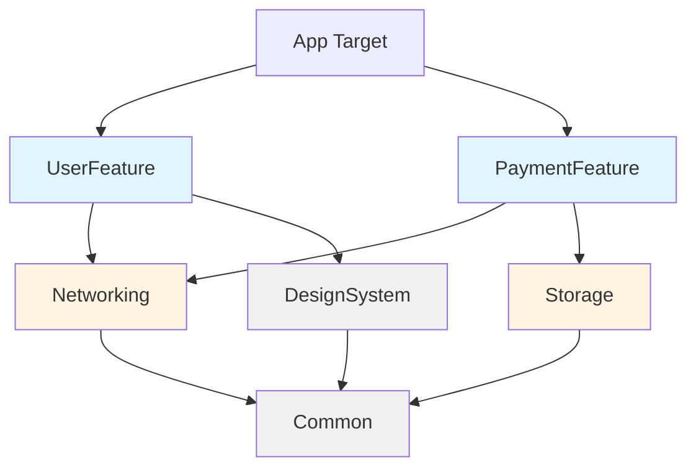

# 工作流：多模块架构的 AI 上下文设计

## 📋 背景

随着 iOS 项目规模增长，单体架构逐渐演进为多模块架构（Swift Package Manager 本地包、Xcode frameworks、feature modules）。在这种架构下直接使用 AI 辅助开发会遇到关键问题：

- **上下文爆炸**：一次性喂入全仓代码导致 token 超限，AI 输出质量下降
- **模块边界模糊**：AI 不理解模块依赖关系，产生越界引用（如 Feature 层直接访问 Core 层内部实现）
- **改动范围失控**：要求改一个模块，AI 却同时修改了多个不相关模块
- **依赖图不清晰**：AI 不知道哪些模块可以依赖哪些模块，生成违反架构规则的代码

本工作流提供一套**上下文工程实践**，让 AI 理解多模块架构的边界与依赖关系，生成符合架构规范的代码。

## 🎯 目标

建立一套可执行的上下文设计流程，让 AI 在多模块项目中：
- **理解模块边界**：明确每个模块的职责范围与公开 API
- **遵守依赖规则**：生成的代码不违反模块依赖层次（如不让 UI 层直接依赖数据库）
- **聚焦改动范围**：只修改目标模块，不产生跨模块的连锁改动
- **提供可验证的输出**：改动后可通过编译、架构检查工具（如 ArchitectureKit）验证

## 🛠️ 适用场景

- ✅ 多模块（SPM 本地包、Xcode framework、CocoaPods Pods）iOS/macOS 项目
- ✅ 已定义清晰的模块分层规则（如 App → Feature → Core → Foundation）
- ✅ 需要跨模块改动但希望 AI 尊重架构边界
- ✅ 新人接手项目，需要快速理解模块依赖关系
- ❌ 单体架构项目（所有代码在一个 target）
- ❌ 架构规则未明确，模块依赖关系混乱的项目

## 📝 工作流步骤

### 步骤 1：生成模块依赖图

#### 1.1 梳理现有模块结构

在项目根目录创建 `ARCHITECTURE.md`（如已有则跳过），记录：

```markdown
# 项目架构

## 模块分层

\`\`\`
┌─────────────────────────────────────┐
│          App (Main Target)          │  ← 应用入口，依赖所有 Feature
├─────────────────────────────────────┤
│  Feature Modules (业务功能模块)      │
│  - UserFeature                      │  ← 用户相关功能
│  - PaymentFeature                   │  ← 支付功能
│  - OrderFeature                     │  ← 订单功能
├─────────────────────────────────────┤
│  Core Modules (核心服务层)           │
│  - Networking                       │  ← 网络请求封装
│  - Storage                          │  ← 数据持久化
│  - Analytics                        │  ← 埋点分析
├─────────────────────────────────────┤
│  Foundation Modules (基础设施层)     │
│  - DesignSystem                     │  ← UI 组件库
│  - Common                           │  ← 通用工具、扩展
└─────────────────────────────────────┘
\`\`\`

## 依赖规则

1. **单向依赖**：高层模块可依赖低层模块，反之不可
   - ✅ UserFeature → Networking
   - ❌ Networking → UserFeature

2. **Feature 模块隔离**：Feature 之间不可直接依赖
   - ❌ PaymentFeature → UserFeature
   - ✅ 通过 App 层协调或通过 Core 层共享接口

3. **仅依赖公开 API**：只能引用 public/open 声明的类型和方法
   - ❌ 引用其他模块的 internal 类型
   - ✅ 使用 public protocol 或 public struct

## 模块清单

| 模块名 | 类型 | 公开 API 入口 | 依赖 |
|--------|------|---------------|------|
| UserFeature | SPM Package | `Sources/UserFeature/Public/` | Networking, DesignSystem |
| Networking | SPM Package | `Sources/Networking/NetworkClient.swift` | Common |
| DesignSystem | Framework | `DesignSystem/Public/` | - |
```

#### 1.2 使用 AI 生成依赖图

使用提示词（见 `prompts/architecture/generate-dependency-graph.md`）让 AI 分析项目结构：

```
请分析这个多模块 iOS 项目的依赖关系。

## 输入
[粘贴项目目录结构，或 Package.swift / Podfile 内容]

## 要求
1. 识别所有模块（SPM Package、Framework、Pods）
2. 分析每个模块的 import 语句，生成依赖图
3. 检查是否有循环依赖或违反分层规则的依赖
4. 输出 Mermaid 格式的依赖图

## 输出格式
- Mermaid 依赖图
- 问题列表（循环依赖、越界依赖）
```

**AI 输出示例：**



**将依赖图保存到 `ARCHITECTURE.md`，并提交到 Git。**

### 步骤 2：为每个模块创建上下文文件

#### 2.1 定义模块上下文结构

在每个模块根目录创建 `MODULE_CONTEXT.md`：

```markdown
# [模块名] 上下文

## 模块职责
[一句话描述模块的核心职责]

## 公开 API
### 核心类型
- `public struct User`
- `public protocol UserServiceProtocol`
- `public enum UserError`

### 核心方法
\`\`\`swift
public func fetchUser(id: String) async throws -> User
public func updateUser(_ user: User) async throws
\`\`\`

## 依赖模块
- Networking：用于 HTTP 请求
- DesignSystem：使用 `DSButton`、`DSTextField` 组件

## 内部实现（AI 不应直接访问）
- `internal class UserRepository`：数据访问层
- `private func validateUserData(_:)`：内部验证逻辑

## 常见使用场景
### 场景 1：获取用户信息
\`\`\`swift
import UserFeature

let service = UserService()
let user = try await service.fetchUser(id: "123")
\`\`\`

### 场景 2：更新用户资料
\`\`\`swift
var user = try await service.fetchUser(id: "123")
user.name = "New Name"
try await service.updateUser(user)
\`\`\`

## 架构约束
- ❌ 不可直接访问数据库（需通过 Storage 模块）
- ❌ 不可引用其他 Feature 模块
- ✅ 可依赖 Networking、DesignSystem、Common
```

#### 2.2 批量生成模块上下文

使用提示词（见 `prompts/architecture/generate-module-context.md`）：

```
为 UserFeature 模块生成 MODULE_CONTEXT.md 文件。

## 模块信息
- 路径：Packages/UserFeature/
- 职责：用户信息管理、用户资料编辑
- 依赖：Networking, DesignSystem, Common

## 要求
1. 分析 Sources/UserFeature/Public/ 下的所有 public 声明
2. 列出核心公开类型和方法签名
3. 记录依赖的外部模块
4. 标注内部实现（internal/private），AI 不应直接修改
5. 给出 2-3 个典型使用场景的代码示例

## 输出
完整的 MODULE_CONTEXT.md 内容
```

**对每个模块重复此步骤**，最终项目结构如下：

```
ios-project/
├── ARCHITECTURE.md                  # 全局依赖图
├── App/
│   └── MODULE_CONTEXT.md
├── Packages/
│   ├── UserFeature/
│   │   ├── MODULE_CONTEXT.md        # UserFeature 上下文
│   │   └── Sources/
│   ├── PaymentFeature/
│   │   ├── MODULE_CONTEXT.md
│   │   └── Sources/
│   └── Networking/
│       ├── MODULE_CONTEXT.md
│       └── Sources/
```

### 步骤 3：跨模块改动前的上下文打包

当需要进行跨模块改动（如新增一个功能涉及多个模块）时，使用分阶段上下文提供策略。

#### 3.1 创建改动清单

创建临时文档 `change-plan.md`：

```markdown
# 改动计划：支持第三方登录

## 涉及模块
1. UserFeature（新增第三方登录 UI）
2. Networking（新增 OAuth 网络请求）
3. Storage（保存第三方账号 token）

## 改动范围
### UserFeature
- 新增 `ThirdPartyLoginView.swift`
- 修改 `public protocol UserServiceProtocol`，添加 `loginWithThirdParty()` 方法

### Networking
- 新增 `OAuthClient.swift`（public class）
- 在 `NetworkClient` 中暴露 OAuth 请求方法

### Storage
- 新增 `TokenStorage.swift`（internal）
- 更新 `public protocol SecureStorageProtocol`

## 依赖变更
- UserFeature 新增对 Networking.OAuthClient 的依赖（已存在 Networking 依赖，无需修改 Package.swift）
```

#### 3.2 分阶段提供上下文

**阶段一：全局架构理解**

```
我需要在多模块 iOS 项目中实现第三方登录功能。

## 项目架构
[粘贴 ARCHITECTURE.md 的依赖图和依赖规则部分]

## 涉及模块
1. UserFeature：负责用户相关功能
2. Networking：负责网络请求
3. Storage：负责数据持久化

## 请先确认
1. 这个改动是否符合架构规则？
2. 是否有遗漏的模块需要修改？
3. 建议的实现顺序是什么？
```

**阶段二：逐模块实现**

针对每个模块单独对话：

```
现在实现 Networking 模块的部分。

## 模块上下文
[粘贴 Packages/Networking/MODULE_CONTEXT.md 内容]

## 任务
1. 新增 `OAuthClient.swift`（public class）
2. 提供方法：`func fetchOAuthToken(provider: String, code: String) async throws -> OAuthToken`
3. 遵循现有 NetworkClient 的错误处理模式

## 约束
- 不修改其他模块
- 只生成 Networking 模块内的代码
- 使用 public 修饰符暴露给 UserFeature
```

**阶段三：集成验证**

```
现在将 Networking.OAuthClient 集成到 UserFeature。

## UserFeature 上下文
[粘贴 Packages/UserFeature/MODULE_CONTEXT.md]

## 已完成
- Networking.OAuthClient 已实现，提供 `fetchOAuthToken()` 方法

## 任务
1. 在 UserService 中调用 OAuthClient
2. 更新 public protocol UserServiceProtocol
3. 新增 ThirdPartyLoginView（SwiftUI）

## 验证点
- 编译通过
- 不引用 Networking 的 internal 类型
- 不直接依赖 Storage（通过 UserService 间接调用）
```

### 步骤 4：公开 API 变更审查

当修改模块的公开 API 时（public 类型、方法、属性），需要审查影响范围。

#### 4.1 使用 AI 审查变更影响

使用提示词（见 `prompts/architecture/review-api-changes.md`）：

```
请审查这次 public API 变更的影响范围。

## 变更内容
[粘贴 git diff 或描述变更]

例如：
- 在 Networking.NetworkClient 中新增 `public func uploadImage(_:)` 方法
- 将 UserFeature.User 的 `var avatarURL: String` 改为 `var avatarURL: URL?`

## 项目依赖图
[粘贴 ARCHITECTURE.md 中的依赖图]

## 要求
1. 列出所有依赖此模块的模块（直接依赖 + 间接依赖）
2. 识别是否为 Breaking Change（方法签名变更、类型删除等）
3. 生成影响清单：哪些模块需要更新、哪些地方会编译报错
4. 建议迁移步骤

## 输出格式
- 影响模块列表
- Breaking Change 清单
- 迁移指南（如需要）
```

**AI 输出示例：**

```markdown
## 影响分析

### 直接依赖 Networking 的模块
- UserFeature
- PaymentFeature
- OrderFeature

### Breaking Changes
❌ **NetworkClient.fetchData() 返回类型变更**
- 旧：`func fetchData(url: String) async throws -> Data`
- 新：`func fetchData(url: URL) async throws -> Data`
- 影响：所有调用处需将 String 转为 URL

### 影响清单
| 模块 | 文件 | 影响 |
|------|------|------|
| UserFeature | UserService.swift:45 | ❌ 编译错误：String 无法转为 URL |
| PaymentFeature | PaymentAPI.swift:23 | ❌ 编译错误 |
| OrderFeature | OrderRepository.swift:67 | ❌ 编译错误 |

### 迁移指南
1. 在 Networking 模块提供兼容方法（deprecated）：
   \`\`\`swift
   @available(*, deprecated, message: "Use fetchData(url: URL) instead")
   public func fetchData(url: String) async throws -> Data {
       guard let urlObj = URL(string: url) else { throw NetworkError.invalidURL }
       return try await fetchData(url: urlObj)
   }
   \`\`\`

2. 逐模块修改调用处，将 String 转为 URL

3. 下个版本移除 deprecated 方法
```

### 步骤 5：验证架构合规性

#### 5.1 编译检查

```bash
# 编译所有模块
xcodebuild build -scheme YourApp -destination 'platform=iOS Simulator,name=iPhone 15'

# 或使用 Swift Package Manager
swift build
```

#### 5.2 使用架构检查工具

如项目使用 `ArchitectureKit` 或自定义脚本：

```bash
# 检查模块依赖是否符合规则
swift run architecture-lint

# 检查是否有未声明的跨模块依赖
./scripts/check-module-dependencies.sh
```

**自定义检查脚本示例（`scripts/check-module-dependencies.sh`）：**

```bash
#!/bin/bash
# 检查 Feature 模块是否违规依赖其他 Feature

echo "检查 Feature 模块间依赖..."

for feature in Packages/*Feature; do
    echo "检查 $feature..."
    # 查找所有 import 语句
    imports=$(find "$feature/Sources" -name "*.swift" -exec grep -h "^import " {} \; | sort -u)
    
    # 检查是否 import 了其他 Feature
    if echo "$imports" | grep -q "Feature"; then
        echo "❌ $feature 违规依赖其他 Feature 模块："
        echo "$imports" | grep "Feature"
        exit 1
    fi
done

echo "✅ 所有 Feature 模块依赖检查通过"
```

#### 5.3 人工审查清单

- [ ] 所有跨模块改动都更新了对应的 `MODULE_CONTEXT.md`
- [ ] 新增的 public API 已记录在 `ARCHITECTURE.md` 的变更日志中
- [ ] 没有 Feature 模块直接依赖其他 Feature 模块
- [ ] 所有模块编译通过
- [ ] 运行架构检查脚本无报错
- [ ] 改动涉及的模块都更新了单元测试

## ✅ 验证清单

- [ ] `ARCHITECTURE.md` 已创建并包含依赖图、依赖规则
- [ ] 每个模块都有 `MODULE_CONTEXT.md`，记录公开 API 和架构约束
- [ ] 跨模块改动使用分阶段上下文提供策略
- [ ] public API 变更经过影响范围审查
- [ ] 编译通过，无 warning
- [ ] 架构检查脚本通过（如有）
- [ ] 改动后更新了相关模块的上下文文档

## 🐛 常见问题

### Q1: AI 生成的代码引用了其他模块的 internal 类型，导致编译错误

**原因**：AI 看到了整个模块的代码，包括 internal 实现，误以为可以访问。

**解决**：
1. 在上下文中明确标注「仅列出 public API」
2. 使用提示词：
   ```
   ## 约束
   - 只能引用 Networking 模块的 public 类型和方法
   - 以下是 Networking 的公开 API：
     [粘贴 MODULE_CONTEXT.md 中的公开 API 部分]
   - 不要引用任何 internal 或 private 声明
   ```

### Q2: 改动一个模块后，依赖它的多个模块都需要更新，工作量太大

**原因**：公开 API 设计不稳定，Breaking Change 过于频繁。

**解决**：
1. **渐进式 API 演进**：
   - 新增方法时不要立即删除旧方法，先标记 `@available(*, deprecated)`
   - 给依赖模块预留迁移时间（如 1-2 个版本周期）

2. **使用协议隔离变化**：
   ```swift
   // 在 Networking 模块定义协议
   public protocol ImageUploadServiceProtocol {
       func uploadImage(_ image: UIImage) async throws -> URL
   }
   
   // 具体实现可以变，但协议签名保持稳定
   public class ImageUploadService: ImageUploadServiceProtocol {
       public func uploadImage(_ image: UIImage) async throws -> URL {
           // 实现可以随时重构
       }
   }
   ```

3. **使用 AI 批量更新**：
   - 使用 `prompts/architecture/review-api-changes.md` 生成影响清单
   - 对每个受影响模块单独对话，让 AI 生成迁移代码
   - 逐模块验证编译通过后再进入下一个

### Q3: 依赖图太复杂，AI 难以理解

**原因**：模块数量过多（如 >20 个），依赖关系交织，上下文超出 token 限制。

**解决**：
1. **分层次提供依赖图**：
   - 只给 AI 当前任务相关的模块子图
   - 例如改动 UserFeature 时，只提供：
     ```
     UserFeature → Networking → Common
     UserFeature → DesignSystem → Common
     ```

2. **使用分组视图**：
   ```markdown
   ## 简化依赖图（按层分组）
   - App 层：App Target
   - Feature 层：UserFeature, PaymentFeature, OrderFeature（共 8 个，仅列举代表）
   - Core 层：Networking, Storage, Analytics
   - Foundation 层：DesignSystem, Common
   
   ## 当前任务相关模块
   - UserFeature（要修改的模块）
   - Networking（依赖的 Core 模块）
   - DesignSystem（依赖的 Foundation 模块）
   ```

3. **使用模块分组策略**：
   - 将 Feature 模块按业务域分组（如 UserDomain、PaymentDomain）
   - 每个域内的模块共享一个 `DOMAIN_CONTEXT.md`

### Q4: 如何处理循环依赖？

**原因**：模块 A 依赖模块 B，模块 B 又依赖模块 A。

**解决**：
1. **识别循环依赖**：
   - 使用 AI 生成依赖图时，会自动标注循环依赖
   - 或使用工具：`swift package show-dependencies --format json | jq`

2. **打破循环的策略**：
   - **协议下沉**：将共享协议提取到更底层的模块
     ```
     错误：UserFeature ⇄ PaymentFeature
     
     正确：
     UserFeature → SharedProtocols ← PaymentFeature
     ```
   
   - **依赖注入**：不直接依赖具体实现，通过 App 层注入
     ```swift
     // UserFeature 中定义协议
     public protocol PaymentHandlerProtocol {
         func handlePayment(_ amount: Decimal)
     }
     
     // App 层注入 PaymentFeature 的实现
     let paymentHandler: PaymentHandlerProtocol = PaymentFeature.PaymentHandler()
     let userService = UserService(paymentHandler: paymentHandler)
     ```

## 🎓 最佳实践

### 1. 上下文文档即代码

- 将 `ARCHITECTURE.md` 和 `MODULE_CONTEXT.md` 提交到 Git
- 在 CI 中检查：改动模块后是否更新了对应上下文文档
- 定期（如每季度）审查上下文文档与实际代码的一致性

### 2. 渐进式喂入上下文

**❌ 错误做法：**
```
分析这个 50 个模块的 iOS 项目，重构 UserFeature...
[粘贴整个项目的目录树和所有 Package.swift]
```

**✅ 正确做法：**
```
# 第 1 轮对话：全局理解
这是一个多模块 iOS 项目，依赖图如下：
[粘贴简化的依赖图]

我需要修改 UserFeature，请先确认改动范围。

# 第 2 轮对话：聚焦单模块
[粘贴 UserFeature/MODULE_CONTEXT.md]
现在重构 UserService.fetchUser() 方法...

# 第 3 轮对话：集成验证
改动完成后，请检查是否影响其他模块：
[粘贴依赖 UserFeature 的模块列表]
```

### 3. 使用工具自动化

- **生成依赖图**：用脚本解析 `Package.swift` 或 `Podfile` 自动生成 Mermaid 图
- **提取公开 API**：用 SourceKit 或 SwiftSyntax 自动提取 public 声明，生成 API 列表
- **检查架构合规**：集成到 CI，每次 PR 自动检查是否违反依赖规则

**自动生成 MODULE_CONTEXT 的脚本（简化版）：**

```bash
#!/bin/bash
# scripts/generate-module-context.sh

MODULE_PATH=$1
MODULE_NAME=$(basename "$MODULE_PATH")

echo "# $MODULE_NAME 上下文" > "$MODULE_PATH/MODULE_CONTEXT.md"
echo "" >> "$MODULE_PATH/MODULE_CONTEXT.md"
echo "## 公开 API" >> "$MODULE_PATH/MODULE_CONTEXT.md"

# 提取所有 public 声明
find "$MODULE_PATH/Sources" -name "*.swift" -exec grep -h "^public " {} \; | sort -u >> "$MODULE_PATH/MODULE_CONTEXT.md"
```

### 4. 定期审计依赖关系

每月或每季度运行依赖图生成脚本，对比变化：

```bash
# 生成当前依赖图
./scripts/generate-dependency-graph.sh > deps-current.json

# 对比上月依赖图
diff deps-last-month.json deps-current.json

# 发现问题：
# + UserFeature -> PaymentFeature  ← 新增的违规依赖
```

将审计结果记录到 `ARCHITECTURE.md` 的变更日志中。

## 🔧 配套工具推荐

### 架构检查工具
- [ArchitectureKit](https://github.com/DmytroAnokhin/ArchitectureKit)：Swift 模块依赖规则检查
- [Sitrep](https://github.com/twostraws/Sitrep)：分析 Swift 项目结构与复杂度
- 自定义脚本：基于 `swift package show-dependencies` 检查循环依赖

### 可视化工具
- [SwiftPackageIndex Dependency Graph](https://swiftpackageindex.com)：在线可视化 SPM 依赖
- Mermaid Live Editor：绘制并导出依赖图
- Graphviz：生成大型项目的依赖关系图

### 上下文管理
- [Cursor Rules Generator](https://cursor.directory)：生成项目级 AI 规则
- 自定义 `.cursor/rules` 文件：将 `ARCHITECTURE.md` 的核心规则写入项目级 prompt

## 📚 扩展阅读

- [Modular Architecture in iOS](https://www.swiftbysundell.com/articles/modular-architecture-in-ios/)
- [Swift Package Manager Best Practices](https://developer.apple.com/documentation/xcode/organizing-your-code-with-local-packages)
- [Context Engineering for Large Codebases](https://github.com/SSLoong/ios-ai-coding-kit/blob/main/docs/context-engineering.md)

## 🔗 相关工作流

- [使用 AI 进行代码 Review](./ai-code-review.md)（可结合架构规则审查）
- [重构遗留 UIKit 代码](./uikit-refactoring.md)（重构时保持模块边界）
- [为 Swift 模块补充单元测试](./unit-test-generation.md)（逐模块补测试）

## 📋 附录：示例项目结构

一个典型的多模块 iOS 项目结构：

```
MyApp/
├── ARCHITECTURE.md                      # 全局依赖图与规则
├── App/                                 # 主 App Target
│   ├── MODULE_CONTEXT.md
│   └── Sources/
│       ├── AppDelegate.swift
│       └── SceneDelegate.swift
├── Packages/                            # SPM 本地包
│   ├── UserFeature/
│   │   ├── MODULE_CONTEXT.md           # UserFeature 上下文
│   │   ├── Package.swift
│   │   └── Sources/
│   │       ├── Public/                 # 公开 API（public）
│   │       │   ├── UserService.swift
│   │       │   └── Models/User.swift
│   │       └── Internal/               # 内部实现（internal）
│   │           └── UserRepository.swift
│   ├── Networking/
│   │   ├── MODULE_CONTEXT.md
│   │   └── Sources/
│   │       └── NetworkClient.swift     # public class
│   └── DesignSystem/
│       ├── MODULE_CONTEXT.md
│       └── Sources/
│           └── Components/
├── scripts/
│   ├── generate-dependency-graph.sh    # 自动生成依赖图
│   └── check-module-dependencies.sh    # 检查架构合规性
└── .cursor/
    └── rules                            # Cursor 项目级 prompt
```

---

**作者**：Loong (SSLoong)  
**更新日期**：2026-11-04  
**适用工具**：Cursor、Claude Code、GitHub Copilot
